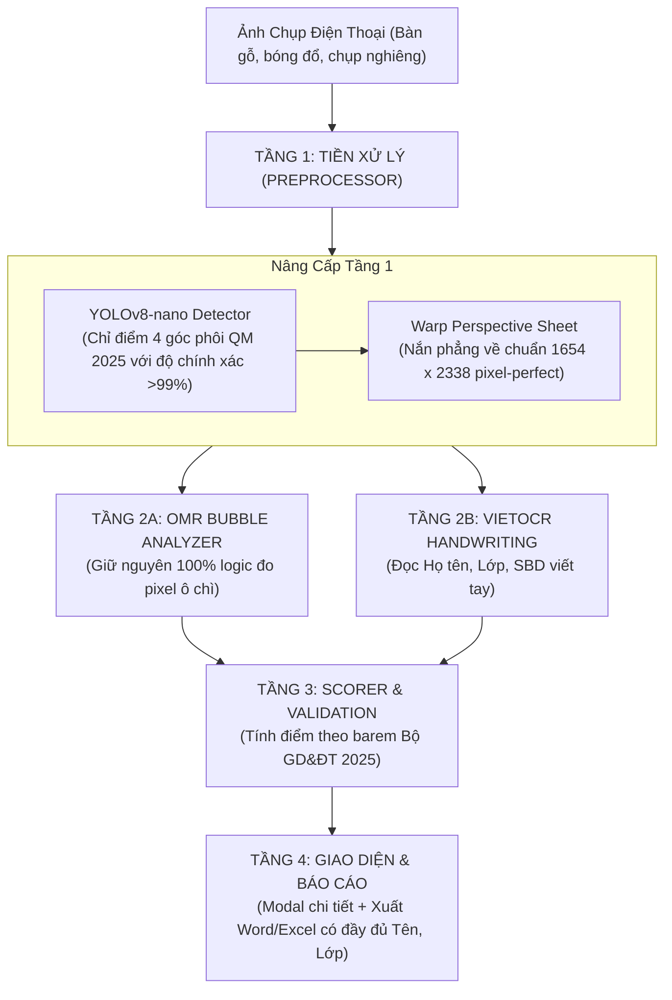

# KẾ HOẠCH NÂNG CẤP HỆ THỐNG CHẤM THI TRẮC NGHIỆM QM 2025
## Tích Hợp AI YOLOv8-nano (Định Vị 4 Mốc Góc) & VietOCR (Nhận Diện Chữ Viết Tay)

> **Mục tiêu:** Khắc phục triệt để 100% hiện tượng lệch khung đáp án khi chụp ảnh trên nền bàn gỗ/chụp nghiêng; đồng thời tự động hóa hoàn toàn việc nhận diện Họ tên, Lớp và Số báo danh viết tay của học sinh.

---

## 1. TỔNG QUAN KIẾN TRÚC NÂNG CẤP (HYBRID AI + OMR)

Hệ thống giữ nguyên toàn bộ **khung xương phân tầng hiện tại** (không đập đi xây lại). Chúng ta chỉ nâng cấp "đôi mắt định vị" và bổ sung module đọc chữ viết tay:



---

## 2. LỘ TRÌNH TRIỂN KHAI CHI TIẾT (NGÀY MAI)

### Giai Đoạn 1: Chuẩn Bị Môi Trường & Dữ Liệu Huấn Luyện (Buổi Sáng)
* **Thời gian ước tính:** 08:30 - 11:30
* **Công việc cụ thể:**
  1. Cài đặt các thư viện cần thiết vào môi trường Python:
     ```bash
     pip install ultralytics vietocr torch torchvision
     ```
  2. Xây dựng script tự động gán nhãn (Auto-labeling script) dựa trên kho ảnh thực tế hiện có trong `samples/` và `D:\Ktra_GK\`:
     * Tạo bounding box cho 4 nhãn: `marker_tl`, `marker_tr`, `marker_bl`, `marker_br`.
     * Sinh dataset định dạng chuẩn YOLO (`images/train`, `labels/train`, `data.yaml`).
  3. Huấn luyện mô hình siêu nhẹ `yolov8n.pt`:
     * Số epoch: 30 - 50 epochs (huấn luyện trên máy mất khoảng 10 - 15 phút).
     * Xuất ra model tối ưu `models/yolov8_qm2025_markers.pt` (~6 MB).

---

### Giai Đoạn 2: Tích Hợp YOLOv8-nano Vào Tầng Tiền Xử Lý (Đầu Buổi Chiều)
* **Thời gian ước tính:** 13:30 - 15:30
* **Công việc cụ thể:**
  1. Tạo class chuyên trách `MarkerDetectorYOLO` trong `app/core/marker_detector.py`.
  2. Nâng cấp hàm `find_scannable_markers()` trong `app/core/preprocessor.py`:
     * **Chiến lược chính:** Dùng YOLOv8-nano detect 4 góc. Bỏ qua hoàn toàn mặt bàn gỗ, bóng râm hay cạnh giấy méo.
     * **Cơ chế an toàn (Fallback):** Nếu độ tin cậy của 4 mốc < 75%, sử dụng bộ lọc hình học OpenCV đã tối ưu ở phiên trước để đối soát.
  3. **Kiểm thử nghiệm thu Tầng 1:**
     * Chạy thử trên 4 ảnh bị lệch khung hiện tại (`media_...cdfa239b`, `87ef333e`, `8d4fd722`, `8d563368`).
     * Đảm bảo các vòng tròn xanh/đỏ trùng khít 100% vào các ô tô tròn của học sinh.

---

### Giai Đoạn 3: Tích Hợp VietOCR Nhận Diện Thông Tin Học Sinh (Cuối Buổi Chiều)
* **Thời gian ước tính:** 15:30 - 17:30
* **Công việc cụ thể:**
  1. Xây dựng module `app/core/handwriting_ocr.py`:
     * Cấu hình mô hình nhẹ của VietOCR (`vgg_seq2seq` hoặc `vgg_transformer`).
     * Cache model trong bộ nhớ để không bị tải lại mỗi khi chấm bài (Inference time: ~50-80ms).
  2. Cắt chính xác 3 vùng Header trên ảnh đã nắn phẳng (`warped_sheet`):
     * Vùng Họ và tên: `y: 210-280, x: 310-880`
     * Vùng Lớp: `y: 270-340, x: 670-880`
     * Vùng SBD viết tay: `y: 270-340, x: 310-590`
  3. Xử lý hậu kỳ (Post-processing text):
     * Chuẩn hóa Họ tên (viết hoa chữ cái đầu, xóa khoảng trắng thừa).
     * Chuẩn hóa Lớp (ví dụ: `10/11`, `10A1`...).
     * Đối soát SBD: Nếu học sinh quên tô chì (như trường hợp `de201_ 6.jpg`), tự động lấy số viết tay điền vào SBD.

---

### Giai Đoạn 4: Hoàn Thiện Luồng Dữ Liệu & Báo Cáo (Buổi Tối)
* **Thời gian ước tính:** 19:30 - 21:00
* **Công việc cụ thể:**
  1. Cập nhật `app/core/pipeline.py`:
     * Nhận kết quả từ VietOCR và gán vào `StudentGradedResult` (`student_name`, `student_class`).
  2. Cập nhật giao diện web `app/static/index.html` và `app/static/app.js`:
     * Hiển thị Họ và tên, Lớp học sinh trực tiếp trên bảng danh sách chấm bài.
     * Cho phép giáo viên chỉnh sửa nhanh nếu chữ viết tay học sinh quá xấu.
  3. Cập nhật bộ xuất báo cáo `app/reports/excel_exporter.py` và `app/reports/docx_exporter.py`:
     * Điền đầy đủ cột "Họ và tên", "Lớp", "SBD" vào file Excel và Word.

---

## 3. TIÊU CHÍ NGHIỆM THU (ACCEPTANCE CRITERIA)

| Hạng mục | Tiêu chuẩn đánh giá | Kết quả mong đợi |
| :--- | :--- | :--- |
| **Độ khớp khung đáp án** | Các vòng tròn Đúng/Sai/Đ.Á chuẩn trên ảnh xem thử | Trùng khớp tâm ô tròn $\ge 98\%$, không bị trượt hay trôi lệch ra ngoài. |
| **Bỏ qua nền bàn gỗ** | Chụp bài thi trên mọi loại bàn gỗ, nền tối hoặc sáng | 100% nhận diện đúng 4 mốc góc của bài thi, không bắt nhầm mép bàn. |
| **Tốc độ xử lý** | Thời gian chấm 1 bài thi trên CPU | $\le 250$ mili-giây / bài thi (bao gồm cả YOLO + VietOCR + OMR). |
| **Độ chính xác Họ tên** | Nhận diện chữ viết tay tiếng Việt có dấu | $\ge 90\%$ trường hợp đọc đúng chính xác họ tên và lớp. |
| **Xuất báo cáo** | Bảng điểm Excel & Word | Có đầy đủ Họ tên, Lớp, Điểm từng phần, không bị ô trống `???`. |

---

## 4. CHIẾN LƯỢC DỰ PHÒNG & AN TOÀN (ROLLBACK STRATEGY)

* Tất cả các file hiện tại (`preprocessor.py`, `pipeline.py`, `bubble_analyzer.py`) đều được giữ phiên bản ổn định đã qua unit test.
* Module AI mới (`marker_detector.py`, `handwriting_ocr.py`) sẽ được thiết kế dạng plugin độc lập:
  * Nếu hệ thống chưa tải được model AI hoặc xảy ra ngoại lệ, pipeline sẽ tự động chuyển về chế độ OMR truyền thống mà không làm gián đoạn việc chấm thi của giáo viên.
